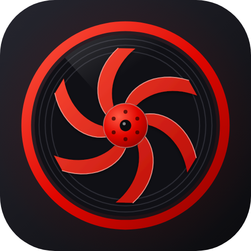
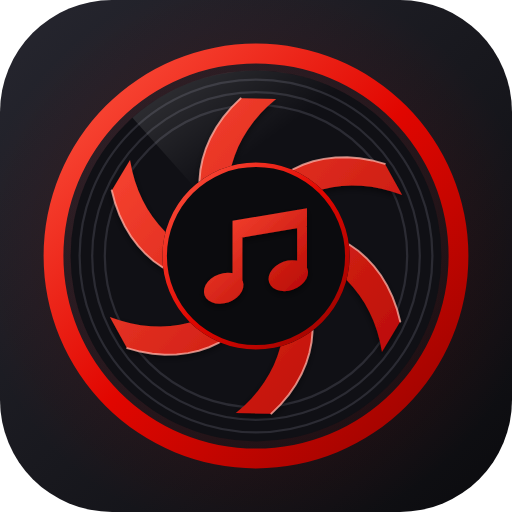

# Logos: one engine mark, one emblem per app

Every TurboNZL app shares **one mark**, the TurboEngine logo, and tells itself apart with an **emblem** laid over the centre. Recommended for every app; source: `TurboNZL/turbomusic` at `f258fb7`, where it runs; the symbol-only small icons come from `TurboNZL/turbokeep` (the owner's rule: favicons must be the coloured symbol alone).

| TurboEngine (no emblem) | TurboMusic (emblem `note`) |
|---|---|
|  |  |

The mark (a lit ring, a record, six curved compressor blades) was drawn for TurboMusic from the owner's avatar colours and is now the engine's. It is generated from geometry; no picture is copied. The older recipe and its reasoning (why it reads at 16 px, how to choose the three tones) is `themes/docs/LOGO.md`; this module is the standard way to apply it.

## The rules
1. **The mark never changes per app, and its red can never be changed.** The tile, the ring (the red rim), the record, the blades, the plate's rim and the glow are always the engine red `#e10600`. Nothing in `branding/logo.json` can recolour them; that fixed red is what makes every TurboNZL app read as one family.
2. **The emblem is the app's identity, and it gets its own unique colour.** It is one flat silhouette, big, on a dark **plate** (radius 130) that replaces the hub, drawn in the app's `emblemColor`. Pick a colour no other TurboNZL app uses so the icon is recognisable at a glance next to the others (the three tones, light, mid and dark, are derived from it by `tones()` in `lib.mjs`). TurboMusic's note is red on purpose (the owner's choice, and the first app); every later app should choose a different hue, and check it against the red rim: avoid near-reds and anything that disappears on `#0b0b0e`. At most three shapes, no text, no outline, nothing thinner than ~7 units of its 100 box (it must survive 32 px). An app with no emblem shows the bare mark (that is the engine's own logo).
3. **At small sizes use ONLY the centre symbol, in the app's own colour.** At 16 to 48 px the full logo is a red ring around a dark dot and the emblem is lost. A favicon, a tab icon or anything that small is the emblem alone on a transparent background (`out.symbolPng`, made by `logo.symbol()`); the full emblem is for 96 px and up (app icons, the web manifest). **The browser tab list is PNGs only: `favicon-32.png` and `favicon-48.png` (the symbol), plus `icon-192.png` (the full emblem) as `<link rel="icon" sizes="192x192">`. Do NOT link the symbol as an SVG (`<link rel="icon" type="image/svg+xml">`):** an SVG icon link has no size (it means "any"), so the browser takes it for every surface that wants a big icon, including an installed PWA's window and taskbar icon (see the gotcha below). `icon.svg` stays the master and the touch/manifest icon. An app with no emblem falls back to the full mark.
4. **Every platform file comes from one config**, never by hand: `branding/logo.json`.

## Using it in an app
1. Copy `files/` (`scripts/gen-icons.mjs`, `scripts/logo/`) and `files/branding/logo.json` to the same paths; add `logos` to `.turboengine.json`.
2. Edit `branding/logo.json`: `name` (also the SVG's `aria-label`), `emblem` (a built-in name, `note`, or the name of your own file), `emblemColor` (the app's own colour as `#rrggbb`; null = engine red, which only TurboMusic uses) and `out`, the paths the app wants. Leave out a key to skip it: `svg`, `mono` (one colour, `currentColor`, for trays and monochrome icons), `png` (list of `[path, size]`, 96 px and up), `symbolSvg` and `symbolPng` (the centre symbol alone, for favicons: see rule 3), `android` (`res` folder and the notification icon's name; Kotlin refers to it, so keep an existing name).
3. From the repository root: `node scripts/gen-icons.mjs` (SVG + Android vectors), `--png` (also PNGs; needs Chromium: `CHROMIUM=<binary>`, and `PLAYWRIGHT_MODULE=<path to playwright's index.mjs>` if `playwright` is not resolvable; in the cloud sandbox `/opt/node-tools/node_modules/playwright/index.mjs`), `--sheet out.png` (a contact sheet: big, 64/48/32/16 px on light and dark, the one-colour twin). Look at the sheet before committing.
4. Commit the generated files. Web: `icon.svg` is the master and the manifest/favicon PNGs follow; Electron derives `.ico`/`.icns` from the 512 PNG; Android gets `ic_launcher_foreground.xml` (flat fills inside the 66 dp safe zone, background colour `#17171c`) and a white `ic_stat_*.xml` notification icon.

## Making an emblem
An emblem is `branding/emblems/<name>.json`: `{ "box": 100, "d": "M..L..Z..." }`, path data in a 100 x 100 square, centred.
- **Only absolute `M`, `L` and `Z`** (polygons; draw curves as short segments, as `note.json` does for the note heads). The generator refuses anything else. That is what lets one shape become an SVG, an Android vector and a one-colour icon with plain arithmetic.
- **Overlapping shapes need the same winding** (clockwise on screen) or they cancel under the nonzero fill and leave a hole.
- Centre it on its bounding box, fill about 70 to 85 % of the box, give it a direction (lean, slant, a diagonal cut) so it is not a button.
- Say it in two words: TurboMusic = a note on a turbo. If you cannot, simplify.
- A prompt that works for an AI agent: "Write `branding/emblems/<name>.json` for <idea>: polygons only (absolute M, L, Z), clockwise, inside a 100 box, at most three shapes, nothing thinner than 7 units. Then run `node scripts/gen-icons.mjs --sheet sheet.png` and fix anything unreadable at 32 px."
- A good emblem for another app can be promoted into `files/scripts/logo/emblems/` here so others can reuse it.

## Gotchas
- **SVG ids are shared by every inline SVG on a page.** `lib.mjs` prefixes them with the app name (`turbomusic-ring`), so two logos can sit on one page (docs, a launcher) without borrowing each other's gradients.
- **The notification icon is the mono twin**, not a cut of the full icon: ring, blades starting at radius 132, the emblem larger. It is white, so the emblem colour does not show there; the shape alone must identify the app. With a plate and rim in white the emblem would merge into the blades.
- **Rings are filled paths, not strokes** (evenodd), so Android vector drawables match the SVG exactly. Circles use relative arcs and are built at their final size; only blades and emblems (absolute polygons) are scaled by arithmetic.
- **The web logo is cached.** TurboMusic's service worker serves `/icon.svg` cache-first and refreshes it in the background, so users see a new logo one visit late. If an app caches it hard, bump the cache name.
- Emblem colour example (illustration only, not an app): a blue play-button emblem with `"emblemColor": "#2f8bff"` keeps the red ring and plate rim and tints only the symbol.
- Colours of the engine red: light `#ff5a44`, mid `#e10600`, dark `#8f0300`. Neutrals are the same everywhere: `#26262f`, `#0b0b0e`, `#101015`, `#2b2b33`.
- Regenerating the engine's own logo: from this repo's root, `node modules/logos/files/scripts/gen-icons.mjs --png` (config `branding/logo.json`). `branding/turbomusic-512.png` is a copy of TurboMusic's icon, shown above for comparison.

## Files
- `scripts/gen-icons.mjs` (the entry point; reads `branding/logo.json`)
- `scripts/logo/lib.mjs` (the mark, tones, emblem placement, SVG / mono / Android output; pure functions)
- `scripts/logo/emblems/note.json` (the beamed note)
- example config: `branding/logo.json` (per app, so not compared by `engine-diff`)

## Gotcha: the installed PWA's taskbar icon showed the coloured symbol (TurboKeep, 2026-10-17; TurboPantry has the same problem)
The first version of rule 3 listed `favicon.svg` (the symbol alone) first in the tab icons. Owner report: with TurboKeep installed as a PWA, the taskbar/window icon was the bare coloured symbol instead of the full emblem, and it stayed that way after clearing the icon cache and reinstalling after a restart. The manifest was right (`icon-192.png`, `icon-512.png`, `icon.svg` are the full emblem; TurboMusic, which has no symbol SVG, shows its PWA icon correctly). The only symbol file that is "any size" was the SVG favicon link, so the cause is very likely that Chromium treats it as the largest favicon and uses it where it wants a large icon. TurboKeep's fix (not yet confirmed on the owner's PC): drop the symbol SVG link, keep `favicon-32.png` / `favicon-48.png` for the tab, add `<link rel="icon" sizes="192x192" href="/icon-192.png">`, and give the manifest an `id` and `scope`. **Any app generated under the old rule 3 (TurboPantry first) needs the same change in its `index.html`**; check its manifest too. Nothing in the generator changes: `symbolSvg` can still be produced, it just must not be linked as an icon.
