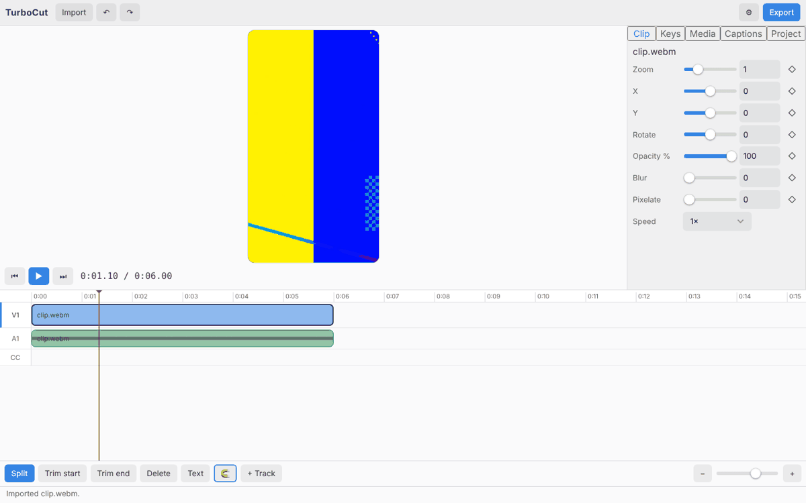
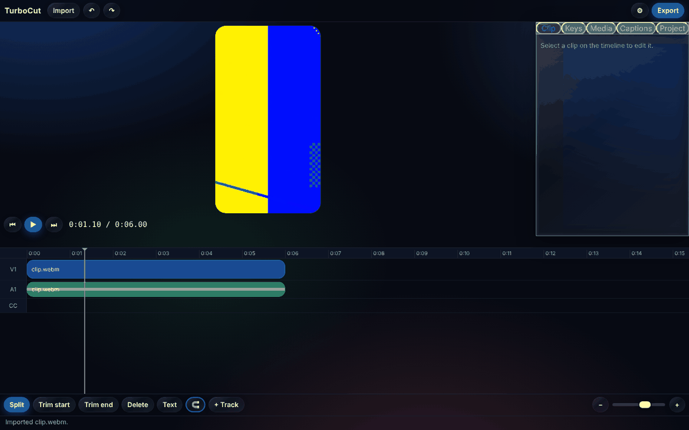
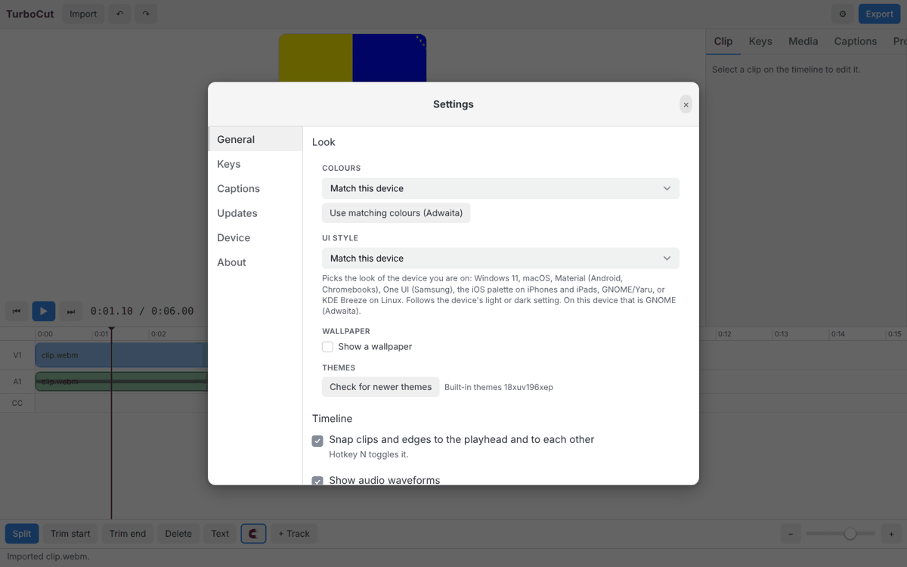
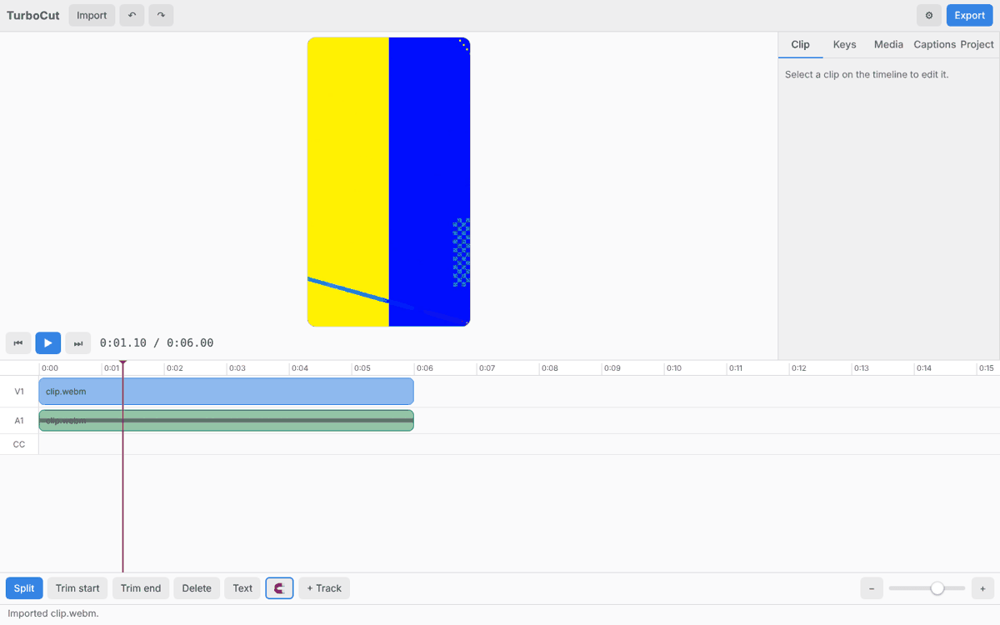
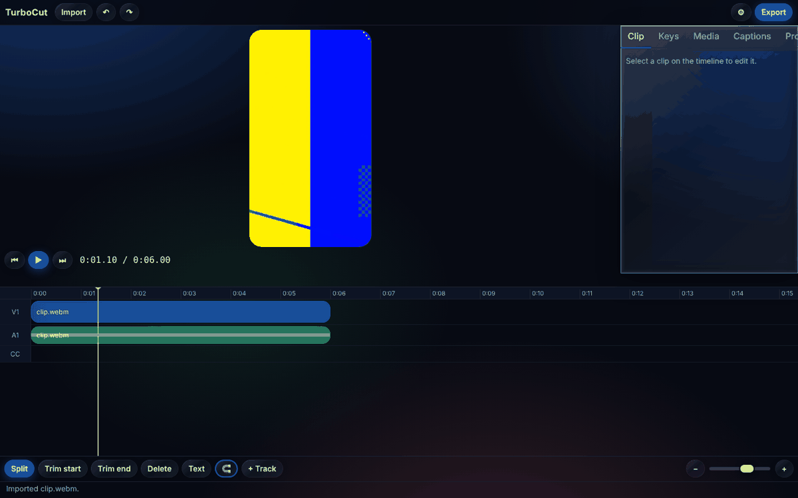
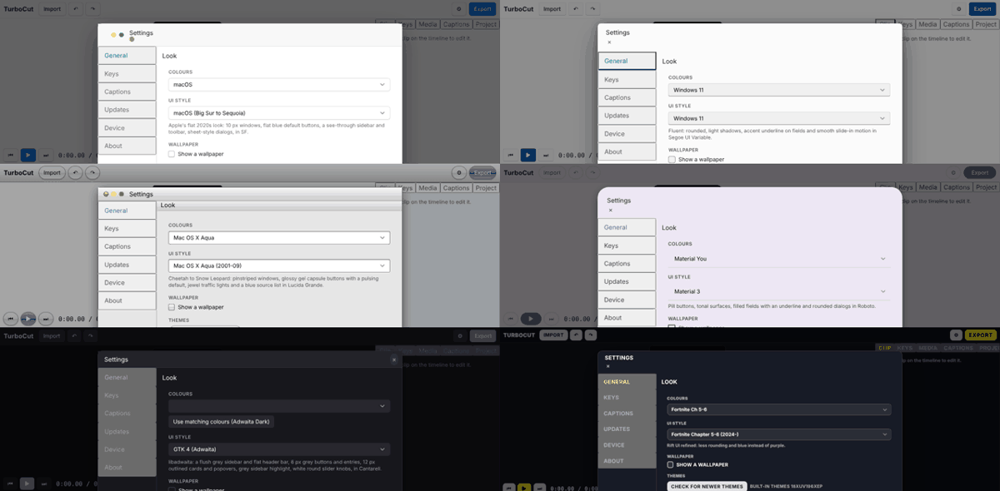
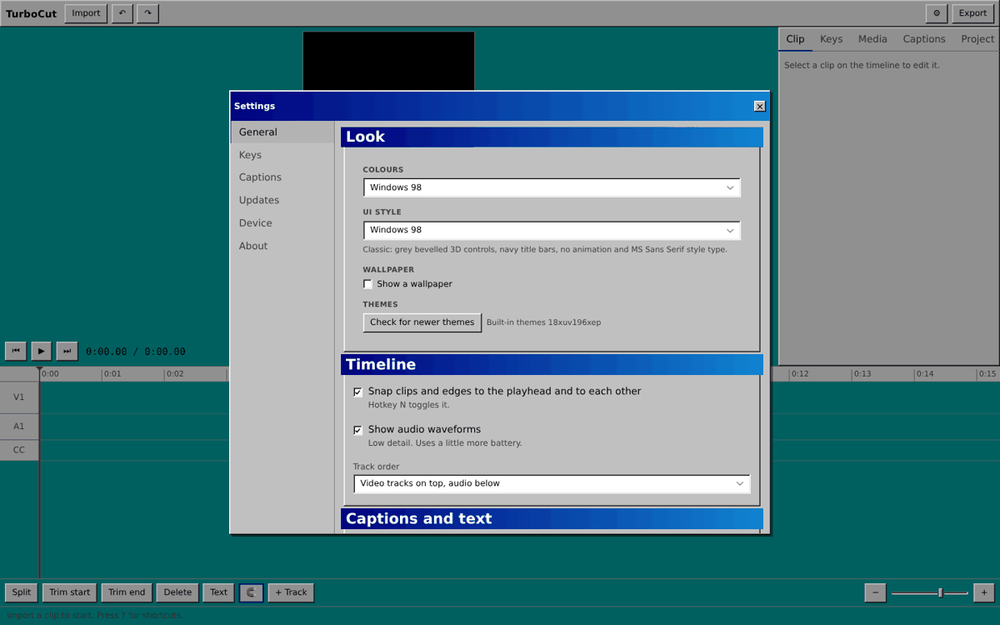

# Audit: TurboCut against TurboMusic (2026-10-13)

What this is: TurboCut (`TurboNZL/turbocut`) and TurboMusic (`TurboNZL/turbomusic`) were both run in headless Chromium and screenshotted under the same looks, at 1440 and 390 px, with dialogs open. TurboMusic is the reference for "turbothemes done properly". This file lists what differs, how bad it is, and the fix **that was tested** (it is in `patches/turbocut-tabs-and-dialog.patch`; nothing was changed in either app repo).

Method, so it can be repeated: TurboMusic ran from a scratch copy against a seeded server (8 albums, 120 votes); TurboCut ran from its own checkout with a generated test clip (`e2e/make-media.sh`). Screenshots for macOS, Windows 11, Aqua, Material, GTK 4, Fortnite Ch 5-6, Windows 98 and Liquid Glass. The automated part is `examples/verify-looks.mjs` (see [INTEGRATION.md](INTEGRATION.md), section 5).

## Verdict

TurboCut's **foundation is right**: `base.css` first, engine started before render, `persist: true`, the picker in Settings, tokens for every colour in `styles.css`, `.btn`/`.input`/`.card`, a themed dialog, sliders with `--p`, no sideways scroll at 390 px. Its colours, buttons, fields and dialog chrome change correctly with every one of the 33 styles.

What looks bad is **a small number of structural mistakes in two places**: the tab strips (editor side panel and Settings list) and the dialog title bar. Everything else is minor. This matches the owner's own read ("the only horrific ui is the tabs for settings and the editor tabs"), and adds the title bar, which is less obvious in the default look but breaks in most others.

| # | Finding | Where | Severity | Tested fix |
|---|---|---|---|---|
| 1 | `.bt-tab` used for in-page tabs: the browser's own bordered grey buttons show through | editor side panel, Settings nav | **High** | token-only tab recipe (INTEGRATION 2.3) |
| 2 | The side panel's tab strip is a `.bt-tabbar` (a phone bottom bar): Liquid Glass draws it as a glass bar with its lens | editor side panel | High (glass styles) | same: plain `.tabs` |
| 3 | Dialog title is a `<span>` in a non-flex `.bt-titlebar`: the close button drops to a second line and the title has no style type | every dialog | **High** (most styles) | `<h2>` + flex titlebar (2.1) |
| 4 | Panel titles are bare `div.bt-panel-title` outside a `.card.bt-panel` | Settings | Medium (Windows 98) | wrap in `section.card.bt-panel` (2.2) |
| 5 | Section headings in the editor panels ("Style", "Auto captions", "Captions") are plain text, unlike Settings | Captions, Project panels | Low | use `bt-panel-title` or one consistent heading class |
| 6 | The snapping button is a coloured emoji (🧲) | timeline toolbar | Low | an SVG icon in `currentColor` (2.6) |
| 7 | Five tabs in a 320 px panel are tight | editor side panel | Low | smaller padding, or widen the panel to ~360 px |
| 8 | Hint paragraphs sit directly on the next heading in the Captions panel | Captions | Cosmetic | add a margin above headings |
| 9 | The style editor's side border uses `var(--bt-border, #8885)`, a variable turbothemes does not define, so it is always a hard-coded grey | `styles.css` (`.style-stage`) | Cosmetic | `hsl(var(--line))` |

Findings 1 to 3 are all about **using a hook for something it is not**, or **leaving out structure the style CSS assumes**. The contract's table says what the hook classes are called; it did not say that `.bt-titlebar` needs an `h2` and flex, that `.bt-panel-title` needs a `.card.bt-panel` parent, or that `.bt-tab` is not a general tab. That is now written down in [INTEGRATION.md](INTEGRATION.md), section 2.

## 1. Tabs



The five tabs on the right (Clip, Keys, Media, Captions, Project) are plain buttons with the browser's own 2 px border and square corners, stuck together; the selected one is only blue text. In TurboMusic the equivalent control (its Settings tabs) is a calm underline strip: muted text, the selected tab in full colour with an accent underline.


Why it happens: TurboCut sets `class="bt-tab"` on each button. In `base.css` the only rule for it is `.bt-tab { color: muted }` and `[aria-current=page] { color: accent }`. The styles never draw a border or background for it because it was only ever meant for the icon+label cells of the phone bar. So the browser's default button border shows, in every style.

The same strip in Liquid Glass, where `.bt-tabbar` makes it a glass bar with a lens and the tabs are outlined pills crammed together:



The Settings dialog's left column has the same problem (see the title-bar screenshot in section 2: the General/Keys/Captions list is a stack of bordered buttons).

After the fix:





## 2. The dialog title bar, in every style



(Top row: macOS, Windows 11. Middle: Aqua, Material. Bottom: GTK 4, Fortnite Ch 5-6.) In macOS a stray close dot sits below the traffic lights; in Windows 11, Material and Fortnite the × is on its own line under the title. Cause: the title is a `<span>` and the bar is not a flex row, so the style's `order`/margin rules for the close button and its `.bt-titlebar h2` type rules do not apply (the title is also drawn in body type instead of the style's title face). After the change the bar is a flex row with an `h2`; every style then places the close button where its platform does (right for Windows, left for macOS) and uses its own title type. The checker reports this as "title bar with the close button on a second line".

## 3. Panel titles



Settings sections are `div.stack` with a `div.bt-panel-title` first. Styles that draw a title as a coloured bar (Windows 98) lay it over the content below with negative margins, which is what the first Windows 98 screenshot shows: the "Track order" select cut by the next bar. Wrapped in `section.card.bt-panel` with an `h2.bt-panel-title`, the bars sit in their own padded panel. (The screenshot shows the result of wrapping them at runtime; the patch does not change the panels, because that is a bigger edit in `settingsDialog.ts` and the owner said only the tabs are horrific. Do it when Settings is next touched. The checker keeps reporting it until then.)

## What is the same as TurboMusic, and good

- CSS order, engine start, persistence, picker, update check.
- Colour only from tokens (`hsl(var(--line))` etc.); radius from `var(--radius)`; the only hex values are black behind video.
- `.btn` for buttons, `.btn-accent` for the primary one per screen, `.input` for fields, `bt-range` sliders, `bt-menu` pop-ups, `bt-backdrop`/`bt-window` dialogs.
- No sideways scroll at 390 px in the looks the checker ran (default, macOS, Windows 98).
- The timeline draws clips from tokens too (video clips from `--accent`, audio from `--good`), so it follows every palette. Only the preview canvas and bin thumbnails use `#000`, which is video content.

## Applying the fix

```
cd turbocut
git apply ../turbothemes/docs/patches/turbocut-tabs-and-dialog.patch
pnpm typecheck && pnpm e2e:settings
node ../turbothemes/examples/verify-looks.mjs --url http://localhost:5173 --open "button[aria-label=Settings], button[title=Settings]"
```

The patch (checked with `git apply --check` against the current TurboCut `main`) does: `.bt-tab` and `.bt-tabbar` become `.tab` / `.tabs` with `role="tablist"`/`"tab"` and `aria-selected`; the dialog title becomes an `h2` in a flex bar; the `.tab` CSS from INTEGRATION.md section 2.3 is added; the e2e test's selector follows. It was verified in Chromium under the default look, Liquid Glass and Windows 98 at 1440 px, and at 390 px under the default look; the checker output went from tabs + title bar + panel titles to the panel titles only.

## What this audit did not cover

Only the editor, the Settings dialog and the style/palette combinations above were looked at. The export dialog, the style editor, the media bin and the keyframe editor were not screenshotted under every style. The Electron and Android builds were not run. Reading the screenshots was done by one reviewer on one machine; treat "looks wrong" calls as a starting point and look at the pictures yourself.
