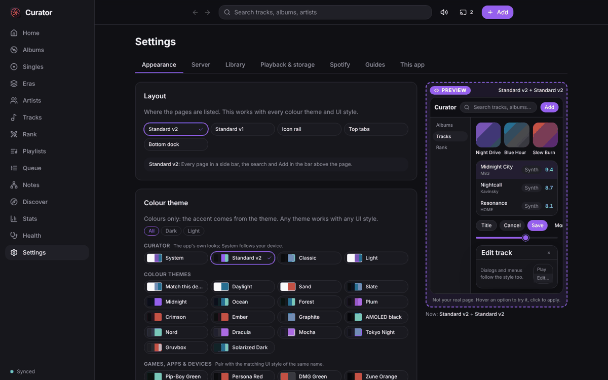

# Adopting turbothemes the way Curator does

Curator (`TurboNZL/curator`, `apps/web`) is the reference implementation: every look in this repo was built and checked against it. TurboCut (`TurboNZL/turbocut`) is the second adopter and the one whose mistakes this guide is built from (see [AUDIT_TURBOCUT.md](AUDIT_TURBOCUT.md) for the screenshots). Read [CONTRACT.md](CONTRACT.md) first for the vocabulary (variables, hook classes, attributes); this file is about **how to apply it so the result looks deliberate in all 33 styles**, not only in the one you are developing in.



The one-sentence rule: **an app supplies structure and layout, a theme supplies every colour, shape, font and motion.** If you catch yourself writing a colour, a radius, a font or a border for a control, you are doing a theme's job and the result will break in some style.

## 1. The wiring (do this once)

### 1.1 Install

```
pnpm add "github:TurboNZL/turboengine#path:/themes"
```

Under CI use the `git+https://github.com/TurboNZL/turboengine.git#path:/themes` form in the lockfile: the `github:` shorthand records an SSH address that CI cannot clone (TurboCut hit this). `dist/` is committed to this repo on purpose, because that is what the package and the updater serve.

### 1.2 CSS order matters

`base.css` holds the default variables and the generic `.btn`, `.input`, `.card`, `.bt-*` rules. They are meant to be **weaker than your own CSS and utility classes**, so import it **before** them:

```css
/* Curator: index.css (Tailwind) */
@import 'turbothemes/base.css';
@tailwind base; @tailwind components; @tailwind utilities;
```
```ts
// TurboCut: main.ts (plain CSS, Vite)
import 'turbothemes/base.css';
import './styles.css';
```

The engine appends the **themes' stylesheet** itself, after yours, and a downloaded update replaces it. So your own CSS must never depend on beating a style's rule with specificity tricks: if you need to override a style, you are fighting the design (section 4).

### 1.3 Start the engine before the first paint

```ts
import { start } from 'turbothemes';
const themes = start({
  persist: true,                 // remember the user's choice (key `<storagePrefix>.appearance`)
  picker: true,                  // register <turbo-themes-picker>
  appearance: { theme: 'auto', ui: 'auto' },   // first visit: match the device
  lens: () => !isPhoneWebView(), // Liquid Glass refraction only where it is smooth
});
```

Call it at module load, before you render anything, so a saved theme never flashes the default one (Curator calls `applyAppearance(settings)` as the second statement of `main.tsx`). Details of every option: [ENGINE.md](ENGINE.md).

Decisions that Curator made, and when you should copy them:

| Curator did | Why | Copy it when |
|---|---|---|
| `fonts: 'none'` and bundles the `@fontsource` fonts itself in `src/fonts.css` | the app must work offline (phone, Pi, LAN) | the app is an installed/offline app. A web-only app can keep the default `'cdn'`. |
| `storagePrefix: 'curator'` | its old keys (`curator.wallpaperImage`) kept working | you migrate an app that already stored something. New apps keep the default. |
| keeps the user's look in its **own** settings and calls `themes.apply(settings)` on every change | settings sync with its server | the look must travel with an account. Otherwise use `persist: true` (TurboCut). |
| `themes.setSource(false)` when the user switches updates off, a GitHub token field for a private repo | the user owns the choice | always offer the "Check for newer themes" button and a way to switch auto-updates off |
| layouts are the **app's** (`layouts.css`, `data-layout`) | where pages are listed is not a theme concern ([CONTRACT.md](CONTRACT.md)) | you have more than one navigation arrangement |

### 1.4 Tailwind apps: use the preset

```ts
import turbothemes from 'turbothemes/tailwind';
export default { presets: [turbothemes], content: ['./index.html', './src/**/*.{ts,tsx}'] };
```

This gives `bg-surface`, `text-muted`, `border-line`, `bg-accent`, `rounded-theme`, `font-sans`. Without Tailwind, use the variables directly: `background: hsl(var(--surface))`, `border: 1px solid hsl(var(--line) / .6)`. They are HSL **triplets**, so `hsl(var(--x))` and `hsl(var(--x) / .5)` both work. Never `var(--x)` alone as a colour.

### 1.5 Give the user a picker

Cheapest: `<turbo-themes-picker></turbo-themes-picker>` in the settings page ([PICKER.md](PICKER.md)); it handles "matching colours", wallpaper and "check for newer themes", and it wears the look it is choosing. Know its two limits before you ship it (details in [PICKER.md](PICKER.md#known-issues-of-the-stock-turbo-themes-picker-varianttiles)): its tiles variant previews a look by restyling the **real page** on hover, which is a bad idea, and it lays the colour chips out one per line. Curator draws its own (`components/AppearanceCard.tsx`: tiles, a live preview, groups) on the headless `themes.picker()` controller, which is worth doing when the picker is a feature of the app, and is the right choice whenever you want the live preview done properly: **hover must only move a mock page, never the real page** ([PICKER.md, section 2a](PICKER.md#2a-previewing-a-look-use-a-mock-page-not-the-real-page); copy `PreviewApp` and the chip grid from the `appearance` module). Either way **put it where a person will find it** and show which look is active.

## 2. The structure you owe the themes

The hook classes in [CONTRACT.md](CONTRACT.md) are only half of it. The rest is DOM structure the style CSS assumes. These are the recipes that work everywhere; each is Curator's markup.

### 2.1 Dialog

```html
<div class="bt-backdrop fixed inset-0 …center it…">
  <div role="dialog" aria-label="Edit track" class="bt-window flex flex-col overflow-hidden …width…">
    <div class="bt-titlebar flex items-center">
      <h2>Edit track</h2>
      <button class="bt-close" aria-label="Close">×</button>
    </div>
    <div class="bt-body overflow-y-auto …padding…">…</div>
    <div class="bt-footer flex items-center gap-2 …padding…">…buttons…</div>
  </div>
</div>
```

Three things that are easy to get wrong, all found in TurboCut:

1. **The title is an `<h2>` and the bar is a flex row.** Styles set the title font, weight, size and shadow on `.bt-titlebar h2`, and place the close button with `order`/margins (left for the macOS traffic lights, right for Windows). A `<span>` title never gets the style's type, and without `display:flex` the close button falls to a second line. Plain-CSS apps need `.bt-titlebar { display:flex; align-items:center }` of their own (Tailwind's `flex items-center` is the same thing).
2. **The window is `flex flex-col overflow-hidden`.** Otherwise rounded corners are not clipped and the body does not scroll inside the frame.
3. **The close button holds a glyph or an icon, nothing else.** The style sizes and colours it; do not add padding or a colour.

### 2.2 Settings panels

```html
<section class="card bt-panel p-5">
  <h2 class="bt-panel-title">Timeline</h2>
  …fields…
</section>
```

A panel title is the **first child of a `.card.bt-panel`**. Styles such as Windows 98 draw it as a coloured bar that bleeds to the card's edges with negative margins (`--panel-tb-margin`); a bare title in a flat `div` leaves that bar overlapping the next control (screenshot in the audit). Give `h2.bt-panel-title` a `font-size` yourself only if the browser's default `h2` size looks wrong in your layout; do not give it a colour.

### 2.3 Tabs (the one thing turbothemes has no hook for)

`.bt-tab` is **only the item of the phone bottom bar** (`.bt-tabbar`), and `.bt-tabbar` is a bar the styles give a border-top, glass and a bottom safe-area. Reusing them for an in-page tab strip is the single biggest cause of ugly UI in TurboCut: the style CSS only sets a colour on `.bt-tab`, so a plain `<button>` keeps the browser's own bordered, grey, outset look, and Liquid Glass turns the strip into a glass bar with a lens.

Until a real hook exists in the engine, an in-page tab strip is the app's own small component, built **from tokens only** so every look works. This is Curator's (`pages/Settings.tsx`) and the version verified in TurboCut:

```html
<div role="tablist" class="tabs">
  <button role="tab" class="tab" aria-selected="true">General</button>
  <button role="tab" class="tab" aria-selected="false">Keys</button>
</div>
```
```css
.tabs { display: flex; border-bottom: 1px solid hsl(var(--line)); }
.tab { appearance: none; background: none; border: 0; border-radius: 0; margin: 0 0 -1px; padding: .6rem .8rem;
       font: inherit; font-weight: 500; color: hsl(var(--muted)); cursor: pointer; white-space: nowrap;
       border-bottom: 2px solid transparent; transition: color var(--dur, 120ms) var(--ease, ease); }
.tab:hover { color: hsl(var(--fg)); }
.tab[aria-selected='true'] { color: hsl(var(--fg)); border-bottom-color: hsl(var(--accent)); }
.tab:focus-visible { outline: 2px solid hsl(var(--accent)); outline-offset: -2px; }
```

For a vertical list (a settings dialog's left column) swap the bottom border for `border-left` and tint the selected one with `background: hsl(var(--hover) / .5)`. On a narrow screen let the strip scroll (`overflow-x:auto`) or give each tab `flex:1; min-width:0; padding-inline:.25rem; font-size:.9rem` rather than letting the last one clip (tested with five short labels in a 320 px side panel: it fits, tightly; widen the panel to about 360 px if labels grow). Use `role="tab"`, `aria-selected` and arrow-key movement; do not use `aria-current="page"` (that is the navigation hook).

The clean fix is a `.bt-tabs` / `.bt-pagetab` hook in `base.css` plus a variable family (`--tabs-*`) so Windows 98 can draw raised folder tabs and macOS a segmented control. That is an engine change (see CLAUDE.md, "Engine vs theme") and has not been made; until then, keep the strip as plain as the recipe above so no look can make it wrong.

### 2.4 Menus, drop-downs, popovers

Anything that floats goes **in a portal at the end of `<body>`**, wears `bt-menu`, items have `role="menuitem"` (or `role="option"`), and the open animation comes from `var(--menu-anim)`. Position it with `fixed`, and measure it with `offsetWidth`/`offsetHeight`: the opening animation scales the box, so `getBoundingClientRect` reports it too small and the menu is clamped wrongly (Curator learned this the hard way). Native `<select>` is acceptable for simple forms (the `.input` class styles it); Curator replaced it with a themed `Select.tsx` where the list itself had to look like the style.

To animate **out**, keep the element mounted for the style's exit time and set `data-leaving`. Curator's `usePresence` (`lib/presence.ts`) reads `--pop-ms`/`--player-ms` from `<html>` with `getComputedStyle`. Without it menus still work; they just vanish instantly in the styles that animate them.

### 2.5 Buttons, fields, cards, rows, sliders

- Every `<button>` is a `.btn` (or `.btn-ghost`, or `.btn-accent` for the one primary action per screen), **including icon buttons**. An unclassed `<button>` is the native browser button. The checker in section 5 finds them.
- Every `<input>`/`<select>`/`<textarea>` is `.input` (checkbox and radio need nothing). Give `.input` a `width`, never a background or border.
- Surfaces are `.card`. Dividers are `1px solid hsl(var(--line))`.
- Sliders are `<input type=range class="bt-range bt-hit">` and the app sets `--p` (the filled percentage) on input (`style={{'--p': '40%'}}`); `.bt-hit` makes the grab area 24 px tall so a thumb is easy to hit on touch.
- Lists: `.bt-row` per row, `.bt-row-current` for the one playing/selected. A chosen **card** is `.bt-sel[data-selected]` (an outline), not a ring or box-shadow.
- Chrome: `.bt-top`, `.bt-side`, `.bt-player`, `.bt-tabbar` mark real bars. Put a bar class on a bar, never on a strip that is not at the edge of the screen.

### 2.6 Icons

Draw icons as inline SVG with `stroke="currentColor"` (Curator uses lucide). A coloured emoji (TurboCut's 🧲 snapping button) ignores the palette, the dark/light mode and the style, and is the first thing to look wrong next to monochrome glyphs. If you must use a character, use a text glyph from the UI font, not an emoji.

### 2.7 Layout

Leave `html`, `body` and `#app` background alone except `body { background: hsl(var(--bg)); color: hsl(var(--fg)); font-family: var(--font) }`. Use `rem`/`em` and the variables `--radius`, `--row-y`, `--grid-min`, so density follows the style. Never scroll sideways: `html, body { overflow-x: hidden }`, give grid/flex children `min-width: 0`, and remember a scroll container (`overflow-y: auto`) is also an x scroller until you say `overflow-x: hidden`. Under 400 px, check every page.

## 3. What a theme gives you for free (so do not rebuild it)

Hover/pressed/focus/disabled states, focus rings, selection colour, `color-scheme` for native pickers and scrollbars, checkbox/radio/slider drawing, window and menu entrance motion, wallpaper translucency (`html[data-wallpaper='on']` makes `.card`, `.bt-side`, `.bt-player`, `.bt-tabbar` translucent), reduced-motion and reduced-transparency handling, the device-matching rules, fonts. If a control needs one of these and does not get it, the fix is its hook class, not a CSS rule in the app.

## 4. When you want to change something

| You want | Do |
|---|---|
| a different colour on one element | use a token (`hsl(var(--accent))`, `--good`, `--warn`, `--bad`, `--top`), never a hex |
| a control to look different in one style | edit that style's folder here (`themes/<id>/style.css`), push, the apps update themselves |
| a new kind of control (tabs, toast, switch) | add the hook class + variables to `engine/base.css`, document it in CONTRACT.md, bump the engine; until then build it from tokens (2.3) |
| an effect scripted in JS | engine release |
| a custom layout of pages | the app's own CSS under `[data-layout=…]` (Curator's `layouts.css`) |

Apps own the **last word** on purpose: a utility class that sets a `.btn`'s background beats the style. That is a feature for one-off needs (a red delete button), and the reason to keep such overrides rare.

## 5. Verify like Curator was verified

Curator's looks were checked with **screenshots under every style at desktop and phone widths, with a dialog open**, not by reading CSS. Do the same:

```
node examples/verify-looks.mjs --url http://localhost:5173 --out shots \
     --open "button[aria-label=Settings]"
```

`examples/verify-looks.mjs` loads the app under eight representative looks (`--looks default:default,macos:macos,win98:win98,liquid:dark,…`) at two widths, opens the dialog you name, saves a screenshot per look and **fails** on: sideways overflow, buttons the browser still draws natively, a title bar whose close button wrapped, a title bar without an `<h2>`, a panel title outside a `.card.bt-panel`, uncaught page errors. It needs the app to persist the look with `persist: true` (or pass `--storage` with your own key). Run it before you claim a screen is themed; then **open the screenshots** and look at them. The checker finds structure mistakes; only a person sees "this tab strip looks wrong".

A good minimum set of looks to look at by eye: `default` (the baseline), `macos` (traffic lights, flat), `win11` (close button on the right, accent underline), `win98` (bevels, coloured panel bars, no motion: the harshest test of structure), `liquid` with a dark palette (glass, lens, floating bars), `fortnite5` (ALL CAPS, slanted shapes) and `material`. If those seven look right, the other 26 almost always do (a rule of thumb from Curator, not a guarantee).

## 6. Checklist for a person or an AI adding turbothemes (or adding a screen to an app that has it)

1. `base.css` is imported before your CSS and utilities; the engine starts before the first render.
2. No hex colours, no hard-coded `border-radius`/`font-family` in app CSS (except the canvas/preview surfaces that are *content*, such as a video frame).
3. Every button is `.btn*`, every field `.input`, every surface `.card`; dialogs, menus, panels, rows and sliders follow section 2.
4. Dialog title = `h2` inside a flex `.bt-titlebar`; panel title = first child of `.card.bt-panel`.
5. Tabs use the token-only recipe in 2.3, not `.bt-tab`/`.bt-tabbar`.
6. Icons are SVG in `currentColor`.
7. A picker (or the tag) is reachable from Settings, plus "Check for newer themes".
8. `examples/verify-looks.mjs` passes and the screenshots were read at 1440 and 390 px.
9. Nothing in the app sets `data-theme`, `data-ui`, `data-mode`, `data-glass` or `data-wallpaper`: those are the engine's.

## 7. Where the reference code is

| Thing | Curator file |
|---|---|
| engine start-up and settings glue | `apps/web/src/lib/appearance.ts`, `main.tsx` |
| CSS entry (`base.css` first) and Tailwind preset | `apps/web/src/index.css`, `tailwind.config.ts` |
| dialog, panel, field recipes | `components/forms.tsx`, `components/Section.tsx` |
| tabs | `pages/Settings.tsx` (`role="tablist"`) |
| menus and portals, exit animation | `components/Menu.tsx`, `components/Select.tsx`, `lib/presence.ts` |
| the picker | `components/AppearanceCard.tsx`, `components/ThemeUpdates.tsx` |
| layouts that are not themes | `lib/layout.ts`, `src/layouts.css` |
| a drawn window frame for the desktop app | `components/WindowFrame.tsx` (`.bt-wf*` hooks) |
