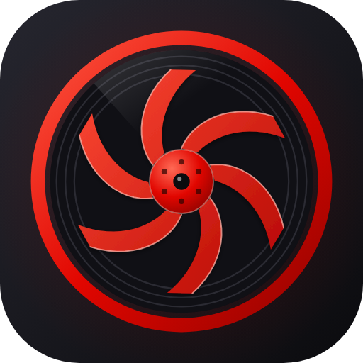
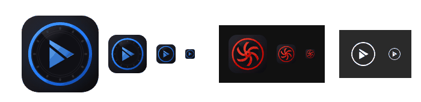

# Logos in the Curator style

Curator's icon is the look the owner wants for every app: a dark rounded tile, a lit ring, a dark record-like disc and one glossy shape in the middle. This guide explains what makes it work, gives the exact numbers, and ships a generator (`examples/logo/make-logo.mjs`) so a new app gets a family-resemblance logo by changing a palette and one function.

| The reference (Curator) | The same recipe for TurboCut |
|---|---|
|  |  |

They read as siblings because **everything except the accent colour and the centre shape is identical**. At small sizes (white page, Curator on dark, the one-colour version for notification icons):



## 1. Why it looks good (the principles)

1. **One accent, three tones.** Everything is near-black except one hue, used as a *highlight*, a *body* and a *shade* (Curator: `#ff5a44` / `#e10600` / `#8f0300`). Never two accent hues.
2. **Concentric structure.** Tile, ring, disc, motif, hub: each is a circle or a shape around the same centre (256, 256). It gives calm and makes the icon recognisable as a *shape* at 16 px.
3. **Depth from four cheap cues**: a soft brand-coloured glow behind everything, a diagonal gradient on every lit surface (light top-left, dark bottom-right, so the light always comes from the same corner), a faint white sheen wedge on the disc, and a drop shadow under the motif.
4. **Detail only where it is quiet.** Fine grooves, bolts and a bright edge line exist at 512 px but are low-contrast (`#2b2b33` on `#101015`), so they vanish at 32 px instead of turning into noise.
5. **One asymmetry.** The motif is twisted (Curator's blades lean 0.95 rad), the sheen sits upper left, and the leading edge has a bright line. A perfectly symmetric icon looks like a button.
6. **Shapes are computed, never traced.** The logo is made from geometry (circles, a parametric blade, a clipped triangle). Colours may come from an avatar or brand, shapes are new: nothing is copied from a picture.
7. **A simpler twin for places the OS tints.** The notification, tray and monochrome icons are the same silhouette in one colour (ring + motif, nothing else).

## 2. The exact recipe (512 x 512 canvas)

Numbers are from `curator/scripts/gen-icons.mjs`; the template in this repo uses the same ones.

| Layer | Value |
|---|---|
| Tile | rounded rectangle `rx = 112` (about 22 %), diagonal gradient `#26262f` (top-left) to `#0b0b0e` |
| Glow | the same rect filled with a radial gradient (r 55 %) of the accent: opacity .30 at the centre, .06 at 70 %, 0 at the edge |
| Content group | everything below is scaled to **0.9** and centred (`translate(25.6 25.6) scale(.9)`), so the ring never touches the tile edge |
| Ring | two circles, radii **236 and 214**, filled `evenodd` (a ring is one filled path, not a stroke, so it scales and converts to an Android vector drawable exactly), diagonal gradient light, mid, dark |
| Disc | circle r **206**, `#101015` |
| Grooves | circles r 196, 182, 168 (the template uses its own radii), stroke `#2b2b33`, width 2.5 |
| Sheen | a wedge from the centre over the upper-left of the disc (angles -2.3 to -0.75 rad), white .16 to 0 |
| Motif | filled with a diagonal gradient (light to dark), drop shadow `dy 3, blur 4, black .55`; **bright edge** = a 2.2 px stroke along its leading edge in a pale tint of the accent at .75 opacity |
| Hub (Curator only) | circle r 50, radial gradient centred at (35 %, 30 %), a lighter rim stroke, six bolts r 4.5 on a circle of r 31, a centre dot r 13 in the ink colour with a tiny white specular dot |

Neutrals are the same in every app: `#26262f`, `#0b0b0e`, `#101015`, `#2b2b33`. Only the accent triple and the edge tint change.

**Choosing the three tones from one brand colour.** Take the brand colour as `mid`. In HSL: `light` = lightness + 18 to 20 points, hue shifted 3 to 5 degrees toward yellow; `dark` = lightness minus 16 to 24 points (Curator's red: 44 % to 28 %; TurboCut's blue: 56 % to 32 %), saturation unchanged; `edge` = same hue at lightness 90 %. TurboCut: `#1f7aff` / `#5fb0ff` / `#0a3a9a` / edge `#cfe6ff`. Check the dark tone against the tile: it must still be clearly lighter than `#101015`, or the ring's lower right disappears.

## 3. Making a logo for a new app

```
node examples/logo/make-logo.mjs out/            # logo.svg + logo-mono.svg
node examples/logo/make-logo.mjs out/ --png      # also logo-512.png, logo-192.png, logo-32.png (needs Chromium)
```

For the PNGs set `CHROMIUM` (path to a Chromium binary) and, if `playwright-core` is not resolvable from the current directory, `PLAYWRIGHT_MODULE` (path to its `index.mjs`). The sandbox's Chromium is at `/opt/pw-browsers/chromium`.

Edit three things in the script:

1. `PALETTE` and `NAME`, and **`ID`**: a short prefix unique to the app. SVG ids (`#ring`, `#fin` ...) are shared by every inline SVG on a page; if two apps' logos are ever inlined together (a docs page, a launcher), the first one's gradients win for both. We hit this while checking: Curator's red ring rendered blue next to the TurboCut logo until the ids were prefixed. (Curator's own `gen-icons.mjs` uses bare ids; this only matters when two logos share a page, not in an `` or a launcher.)
2. `motif()`: returns `{ body, edges }` as SVG path data in the 512 coordinate system, centred on (256, 256).
3. Optionally the ring decorations (`holes`, `grooves`): Curator has record grooves, TurboCut has film sprocket holes. These are the app's "slot" for a second idea.

**Rules for a motif** (what makes it fit the family and survive small sizes):

- One silhouette, at most three filled shapes, **no text, no outlines**, nothing thinner than 14 px at 512 (it must still be visible at 32 px).
- Inside radius **about 176** of the centre (the disc is 206; leave a margin so the motif never touches the grooves).
- A direction: lean it, twist it, or cut it diagonally, so it is not symmetric. TurboCut's is a play triangle cut in two by a diagonal slash ("cut"); Curator's is six curved compressor blades.
- Named by the app's one verb: Curator = a record that is also a turbo (music, speed); TurboCut = play + cut. If you cannot say it in two words, simplify.
- Must look right when the same shape is filled with a single flat colour: that is the mono icon.

A prompt that works for an AI agent: "Edit `motif()` in `examples/logo/make-logo.mjs` to draw <idea> as at most three filled polygons or paths inside radius 176 around (256, 256), leaning or cut diagonally, no text. Keep PALETTE neutrals; set the accent triple from <brand colour>. Render with `--png`, look at logo-512.png and logo-32.png, and fix anything that is unreadable at 32 px."

## 4. The files an app needs

| Where | File | Notes |
|---|---|---|
| Web | `icon.svg` (the full logo), `icon-512.png`, `icon-192.png`, `favicon-32.png`, manifest icons | The SVG is the master. Cache-bust the service worker when the logo changes (Curator once kept an old icon forever because the shell cache was cache-first). |
| Electron | `build/icon.png` (512), `build/icon-256.png` | electron-builder derives `.ico`/`.icns` from the 512 PNG. |
| Android launcher | `ic_launcher_foreground.xml` (vector) + `ic_launcher_background` colour `#17171c` | Adaptive icons draw the foreground inside the **66 dp safe zone of a 108 dp canvas**; the OS masks the rest. Flat fills only, no gradients or filters: use ring + disc + motif + hub as solid paths (Curator's `launcherForeground`). |
| Android notification | `ic_stat_<app>.xml` | **White only on transparent**, 24 dp, ring + motif + hub; Android tints it. This is the mono icon. |
| Tray (desktop) | the mono SVG at 16/32 px | Use the full-colour logo on Windows and Linux, the mono on macOS menu bar (template image). |

Curator's `scripts/gen-icons.mjs` produces all of these for that app (SVG, Android vector drawables, PNGs through Chromium); copy its structure for the platform outputs. The template here does the SVG, mono and PNGs, which is what a web or Electron app needs; the Android conversion (scaling the 512 paths into the 108 viewport and dropping gradients) is in `gen-icons.mjs`, functions `tx`, `scaledCircle` and `launcherForeground`.

## 5. Check it before you ship it

1. Open the 512 PNG: is the motif the clear first read, then the ring, then the detail?
2. Open it at **32 and 16 px** on a white page and on a dark page. The silhouette (ring + motif) must be readable; the grooves may vanish.
3. The mono version at 24 px on a dark grey: ring and motif only, no filled blobs where gradients were.
4. Put it next to the other apps' logos: same tile shape, same neutrals, different accent.
5. Never ship the logo with an `` that says only "logo": the SVG carries `role="img" aria-label="<App name>"`.
